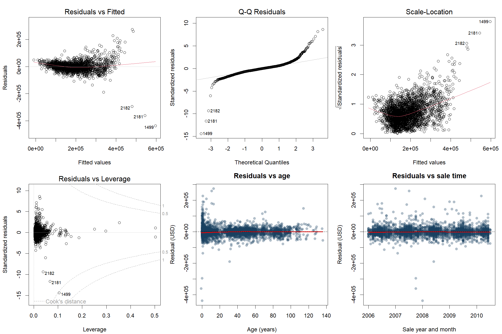
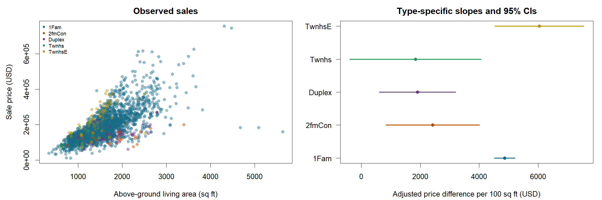

```{r setup, include=FALSE}
knitr::opts_chunk$set(echo=FALSE, message=FALSE, warning=FALSE)
# Run from the ames_proposal folder. Base R only; no package installation needed.
options(stringsAsFactors = FALSE)
dir.create('outputs', showWarnings = FALSE)
raw <- read.delim('data/AmesHousing_original.txt', check.names = FALSE,
                  colClasses = 'character', na.strings = '', strip.white = TRUE)
stopifnot(nrow(raw) == 2930, ncol(raw) == 82)
write.csv(raw, 'data/AmesHousing_original.csv', row.names = FALSE, na = '')
num <- function(name) suppressWarnings(as.numeric(raw[[name]]))
d <- data.frame(PID=raw$PID, SalePrice=num('SalePrice'),
  Living100=num('Gr Liv Area')/100, Building=factor(raw[['Bldg Type']]),
  Lot1000=num('Lot Area')/1000, Quality=num('Overall Qual'),
  Age=num('Yr Sold')-num('Year Built'), Basement100=num('Total Bsmt SF')/100,
  GarageCars=num('Garage Cars'), Neighborhood=factor(raw$Neighborhood),
  SaleYear=factor(raw[['Yr Sold']]), SaleMonth=num('Mo Sold'))
d$Building <- relevel(d$Building, '1Fam')
d$Neighborhood <- relevel(d$Neighborhood, 'NAmes')
vars <- c('SalePrice','Living100','Building','Lot1000','Quality','Age',
          'Basement100','GarageCars','Neighborhood','SaleYear')
missing <- data.frame(Variable=vars, Missing=sapply(d[vars],function(x)sum(is.na(x))))
write.csv(missing,'outputs/missingness.csv',row.names=FALSE)
keep <- complete.cases(d[vars])
write.csv(d[!keep,],'outputs/excluded_missing.csv',row.names=FALSE)
clean <- droplevels(d[keep,])
stopifnot(nrow(clean)>=1000, !anyDuplicated(clean$PID), all(clean$SalePrice>0))
write.csv(clean,'data/AmesHousing_cleaned.csv',row.names=FALSE)
# Centering and unit changes aid interpretation; no log transform or outlier removal.
clean$LivingC <- clean$Living100 - 15
fit <- lm(SalePrice ~ LivingC*Building + Lot1000 + Quality + Age +
          Basement100 + GarageCars + Neighborhood + SaleYear, data=clean)
stopifnot(fit$rank == ncol(model.matrix(fit)))
write.csv(data.frame(n=nobs(fit),sigma=summary(fit)$sigma,
 adjusted_r_squared=summary(fit)$adj.r.squared),'outputs/metrics.csv',row.names=FALSE)
co <- summary(fit)$coefficients
ci <- confint(fit)
write.csv(data.frame(Term=rownames(co),Estimate=co[,1],SE=co[,2],
                    Lower=ci[,1],Upper=ci[,2],P=co[,4]),
          'outputs/coefficients.csv',row.names=FALSE)
numeric_vars <- vars[sapply(clean[vars],is.numeric)]
summ <- do.call(rbind,lapply(numeric_vars,function(v){
 x <- clean[[v]]
 data.frame(Variable=v,N=length(x),Mean=mean(x),SD=sd(x),Min=min(x),
            Q1=unname(quantile(x,.25)),Median=median(x),Q3=unname(quantile(x,.75)),Max=max(x))
}))
write.csv(summ,'outputs/numeric_summary.csv',row.names=FALSE)
cats <- do.call(rbind,lapply(setdiff(vars,numeric_vars),function(v){
 t <- table(clean[[v]])
 data.frame(Variable=v,Level=names(t),N=as.integer(t),Percent=100*as.integer(t)/nrow(clean))
}))
write.csv(cats,'outputs/categorical_summary.csv',row.names=FALSE)
slopes <- do.call(rbind,lapply(levels(clean$Building),function(b){
 L <- setNames(rep(0,length(coef(fit))),names(coef(fit))); L['LivingC'] <- 1
 if(b!='1Fam')L[paste0('LivingC:Building',b)] <- 1
 est <- sum(L*coef(fit)); se <- sqrt(drop(t(L)%*%vcov(fit)%*%L))
 data.frame(Building=b,Estimate=est,SE=se,Lower=est-qt(.975,df.residual(fit))*se,
            Upper=est+qt(.975,df.residual(fit))*se)
}))
write.csv(slopes,'outputs/area_slopes.csv',row.names=FALSE)
reduced <- update(fit,.~.-LivingC:Building)
test <- anova(reduced,fit)
write.csv(test,'outputs/interaction_test.csv')
influence <- data.frame(PID=clean$PID,CooksD=cooks.distance(fit),
 Leverage=hatvalues(fit),Studentized=rstudent(fit))
write.csv(influence[order(-influence$CooksD),],'outputs/influence.csv',row.names=FALSE)
png('outputs/diagnostics.png',width=2100,height=1400,res=180)
par(mfrow=c(2,3),mar=c(4.2,4.2,2.5,1),cex=.8)
plot(fit,which=1,id.n=3)
plot(fit,which=2,id.n=3)
plot(fit,which=3,id.n=3)
plot(fit,which=5,id.n=3)
plot(clean$Age,resid(fit),pch=16,col='#173f5f55',xlab='Age (years)',ylab='Residual (USD)',main='Residuals vs age')
lines(lowess(clean$Age,resid(fit)),col='red',lwd=2); abline(h=0,lty=2)
time <- as.numeric(as.character(clean$SaleYear))+(clean$SaleMonth-1)/12
plot(time,resid(fit),pch=16,col='#173f5f55',xlab='Sale year and month',ylab='Residual (USD)',main='Residuals vs sale time')
lines(lowess(time,resid(fit)),col='red',lwd=2);abline(h=0,lty=2)
dev.off()
png('outputs/interaction.png',width=2100,height=700,res=180)
par(mfrow=c(1,2),mar=c(4.2,4.5,2.4,1),cex=.85)
cols <- c('#176b87','#ba4a00','#6c3483','#229954','#b7950b')
plot(clean$Living100*100,clean$SalePrice,pch=16,col=adjustcolor(cols[clean$Building],alpha.f=.45),
 xlab='Above-ground living area (sq ft)',ylab='Sale price (USD)',main='Observed sales')
legend('topleft',legend=levels(clean$Building),col=cols,pch=16,cex=.7,bty='n')
plot(slopes$Estimate,seq_len(nrow(slopes)),xlim=range(slopes$Lower,slopes$Upper),yaxt='n',
 xlab='Adjusted price difference per 100 sq ft (USD)',ylab='',pch=19,col=cols,main='Type-specific slopes and 95% CIs')
axis(2,at=seq_len(nrow(slopes)),labels=slopes$Building,las=1)
segments(slopes$Lower,seq_len(nrow(slopes)),slopes$Upper,seq_len(nrow(slopes)),col=cols,lwd=2)
dev.off()
capture.output({cat('Original:',nrow(raw),' Complete:',nrow(clean),' Excluded:',sum(!keep),'\n');
 print(summary(fit));print(slopes);print(test);print(summ);
 cat('Largest finite Cook D:',max(influence$CooksD,na.rm=TRUE),'\n');
 cat('Leverage-one cases (undefined standardized diagnostics):',sum(influence$Leverage>1-1e-8),'\n');
 cat('Negative ages:',sum(clean$Age<0),'\n'); print(sessionInfo())},file='outputs/model_log.txt')
saveRDS(fit,'outputs/preliminary_model.rds')

```

**Working draft:** confirm Ames eligibility; replace team and Module 3 placeholders.

## Contributions
[Member A]: [actual contribution]. [Member B]: [actual contribution]. [Member C]: [actual contribution]. [Member D]: [actual contribution].

## Introduction
Among residential properties sold in Ames, Iowa, during 2006-2010, does the association between above-ground living area and sale price differ by dwelling type after adjustment for lot area, construction quality, age, basement area, garage capacity, neighborhood, and sale year? Sale price is the recorded transaction amount in nominal US dollars. Our target is the adjusted dollar difference associated with 100 additional square feet within each dwelling type, rather than the causal return from enlarging a home.

Housing attributes need to be considered jointly. Mathur (2019), studying King County, Washington, found that construction quality and maintenance were associated with higher prices; a medium-quality home sold for approximately 25% more than a low-quality home. This supports adjustment for quality, while its maintenance findings motivate considering condition in subsequent models. Goodman and Thibodeau (1995), analyzing nearly 8,500 Dallas single-family transactions, found nonlinear depreciation and age-related heteroskedasticity. Their findings motivate including age and checking both functional form and residual variance. Fik et al. (2003), studying the Tucson housing market, found that location and housing attributes jointly influenced prices in ways that simple location indicators did not fully capture. This motivates neighborhood adjustment and cautions that such adjustment may leave spatial dependence.

Together, these studies support an adjusted analysis while warning against a universal price-per-square-foot rule. Our extension asks whether the living-area slope varies across five recorded dwelling types in Ames. We hypothesize that differences in layout and shared structures make a common slope too restrictive. This is a proposed local extension, not a claim that dwelling-type interactions have never been studied.

Multiple linear regression estimates conditional mean-price differences while adjusting for several characteristics simultaneously. A correlation or comparison of group means cannot isolate the adjusted area association or test whether slopes differ. Type-specific slopes, confidence intervals, and a joint partial F-test of the four interaction coefficients answer the question. The outcome is sufficiently continuous for this approach, subject to diagnostic assessment. Historical housing researchers and appraisers studying comparable-property adjustments could benefit; the estimates are not current valuations and should not be transferred directly to Toronto or contemporary Ames.

## Data description
We downloaded the original tab-delimited data and codebook from the Journal of Statistics Education archive (De Cock, 2011). The Ames City Assessor's Office originally recorded property characteristics and sales for valuation and assessment. De Cock obtained a records-system extract, removed specialized assessment variables and nonresidential records, and retained the latest transaction for repeatedly sold properties. His public release contains 2,930 properties and 82 fields and was curated for regression teaching.

The analysis uses 2,928 complete records, excluding one missing basement area and one missing garage capacity. Sale price has mean $180,841, median $160,000, standard deviation $79,890, and range $12,789-$755,000. Its many possible values support a continuous response; right skew does not itself invalidate regression, whose assumptions concern conditional errors. Unique parcel identifiers reduce repeated-property dependence, but neighboring homes and common market conditions can still produce dependent errors.

Nine predictors enter the model: living area, dwelling type, lot area, overall quality, age at sale, basement area, garage capacity, neighborhood, and sale year. Dwelling type and neighborhood are nominal; sale year is a factor. Quality is provisionally treated as a numerical 1-10 score, imposing equal increments. Living area is measured per 100 square feet and centered at 1,500 square feet; lot area is per 1,000 square feet and basement area per 100 square feet. These unit changes do not repair model assumptions.

The living-area-by-dwelling-type interaction allows different slopes for detached homes, converted two-family homes, duplexes, and interior/end-unit townhouses. These are existing categories, so no arbitrary numerical cutoffs are needed. Figure 2 displays the adjusted slopes; differing layouts provide the substantive motivation.

Table 1. Complete-case summaries. Prices and areas have long upper tails. Original missing counts: basement area 1, garage capacity 1; all other selected variables 0. One age equals -1; retain for investigation. Dwelling types are imbalanced; Landmrk has one observation.

```{r summary-tables, results="asis"}
knitr::kable(read.csv('outputs/numeric_summary.csv'), digits=2, row.names=FALSE)
knitr::kable(read.csv('outputs/categorical_summary.csv'), digits=2, row.names=FALSE)
knitr::kable(read.csv('outputs/missingness.csv'), row.names=FALSE)
```

## Ethics discussion
Administrative provenance, a published codebook, and a reproducible cleaning record support traceability and measurement transparency. Trustworthiness nevertheless depends on fitness for purpose: assessor quality ratings are subjective, one computed age is negative, and the released sample contains only sold properties from one city and period. Public availability alone does not establish accuracy or representativeness.

The curator obtained the records from the Assessor's Office and publicly released a research dataset. We have not verified individual homeowner consent, so we should not claim that every owner consented to this secondary use. Parcel identifiers can link records to addresses and owners; we retain them only for reproducibility and duplicate checks, do not perform identity linkage, and report aggregate findings. Restrict course-data sharing to the required UofT audience.

Neighborhood coefficients may reflect historical inequalities and omitted amenities. They must not be interpreted as intrinsic community quality or used to justify discriminatory lending or pricing. We will describe associations and uncertainty, avoid causal renovation advice, and acknowledge limited geographic and temporal generalizability. [Replace or connect these concepts to the exact Module 3 terminology before submission.]

## Preliminary results
The untransformed preliminary model uses nine predictors and the four living-area interaction coefficients (46 coefficients including the intercept). Adjusted R-squared is 0.8388 and residual standard error is $32,073. Table 2 reports every coefficient with its conventional OLS standard error and 95% confidence interval.

For detached homes, 100 additional square feet is associated with $4,860 higher mean price (95% CI $4,507-$5,212), holding the other predictors fixed. Corresponding slopes are $2,419 for converted two-family homes, $1,900 for duplexes, $1,832 for interior townhouses, and $6,042 for end-unit townhouses. The interaction block has F(4,2882)=9.20, p=2.22e-7. These are provisional model-based comparisons; the diagnostics undermine conventional inferential calibration.

Figure 1 shows curved residual means and increasing spread at high fitted prices, suggesting imperfect linearity and unequal variance. The scale-location trend reinforces the latter. Strong Q-Q tail departures contradict normal errors, with several extreme negative residuals. Cook's distance reaches 0.530. Landmrk has one property and leverage one; its standardized residual and Cook's distance are undefined and omitted from relevant diagnostic panels. The design matrix is full rank, but this does not imply stable estimates or negligible collinearity. Sale-time residuals show no strong smooth trend; they cannot establish independence, especially with possible neighborhood dependence.

The positive quality coefficient ($15,672 per rating point) is directionally consistent with Mathur (2019), although scales and populations differ. Age has a negative linear coefficient ($404 per year), while the residual-age plot shows especially large spread among newer properties. This does not reproduce a simple increasing-variance-with-age pattern from Dallas and reinforces the need for local diagnostics. Neighborhood adjustment follows Fik et al. (2003), but cannot establish absence of spatial effects. No transformations, rare-level pooling, or influential-case deletions have been applied.

```{r diagnostics, out.width="100%", fig.cap="Figure 1. Preliminary model diagnostics. Curvature, unequal spread, heavy tails, and influential observations warrant investigation. Labels identify original row numbers; the leverage-one case is omitted from standardized panels."}

```

```{r interaction, out.width="100%", fig.cap="Figure 2. Observed prices and adjusted living-area slopes by dwelling type. Intervals are conventional 95% OLS intervals; assumption violations limit inference."}

```

Table 2. Full preliminary model, USD. References: detached home, North Ames (NAmes), 2006. Dwelling-type contrasts are at 1,500 square feet. Interactions are slope differences per 100 square feet. Conventional intervals assume the model conditions hold.

```{r coefficients, results="asis"}
knitr::kable(read.csv('outputs/coefficients.csv')[1:5], digits=2, row.names=FALSE, longtable=TRUE)
```

## Plan
Retain living area, dwelling type, and their interaction because they define the question; retain neighborhood and sale year as contextual controls. Preserve all main effects whenever an interaction is included. Compare scientifically justified nested specifications using partial F-tests once assumptions are reasonably supported, and use adjusted R-squared as supporting rather than decisive evidence. Avoid automatic elimination of individual factor levels or selection solely by p-values. Consider adding overall condition and remodeling information, motivated by maintenance research, while checking redundancy among structural measures.

Recheck residual-versus-fitted, Q-Q, scale-location, leverage, and residual-age/time plots after every substantive revision. The fan-shaped spread suggests considering log sale price; curvature suggests quadratic age or living-area terms. Compare diagnostic improvement and interpretability rather than assuming a log transform fixes everything. Investigate the negative age and unusual large-property transactions against the codebook before any correction or exclusion. Assess rare-neighborhood instability, possible collinearity, and neighborhood dependence; discuss methods beyond course scope with the TA. Document sensitivity analyses rather than removing observations to achieve significance.

Proposed schedule (the final submission is at the end of November; confirm the exact date): October 30-31, [Member A] and [Member B] verify sources and data. November 1-3, [Member C] checks code and [Member D] checks interpretation. November 4, all members review; November 5, [Submitter] submits the proposal. November 9-15, [Members A/C] investigate diagnostics and compare revisions. November 16-20, [Members B/D] finalize interpretation and create the poster. November 21-25, all members rehearse and record the presentation. November 26-28, all members audit reproducibility and submission files, leaving a buffer before the confirmed deadline. Combine roles if the team has fewer than four members.

## Bibliography
De Cock, D. (2011). Ames, Iowa: Alternative to the Boston housing data as an end of semester regression project. Journal of Statistics Education, 19(3). https://doi.org/10.1080/10691898.2011.11889627

Fik, T. J., Ling, D. C., & Mulligan, G. F. (2003). Modeling spatial variation in housing prices: A variable interaction approach. Real Estate Economics, 31(4), 623-646. https://doi.org/10.1046/j.1080-8620.2003.00079.x

Goodman, A. C., & Thibodeau, T. G. (1995). Age-related heteroskedasticity in hedonic house price equations. Journal of Housing Research, 6(1), 25-42. https://www.jstor.org/stable/24825889

Mathur, S. (2019). House price impacts of construction quality and level of maintenance on a regional housing market: Evidence from King County, Washington. Housing and Society, 46(2), 57-80. https://doi.org/10.1080/08882746.2019.1601928

Data and codebook: <https://jse.amstat.org/v19n3/decock/AmesHousing.txt> and <https://jse.amstat.org/v19n3/decock/DataDocumentation.txt>. Accessed October 29, 2026.