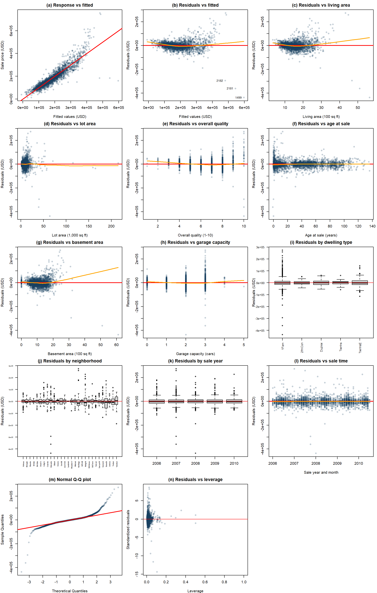
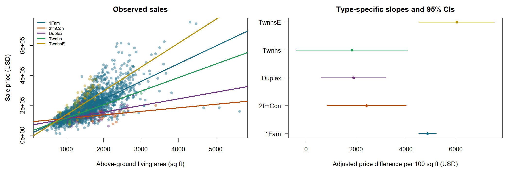
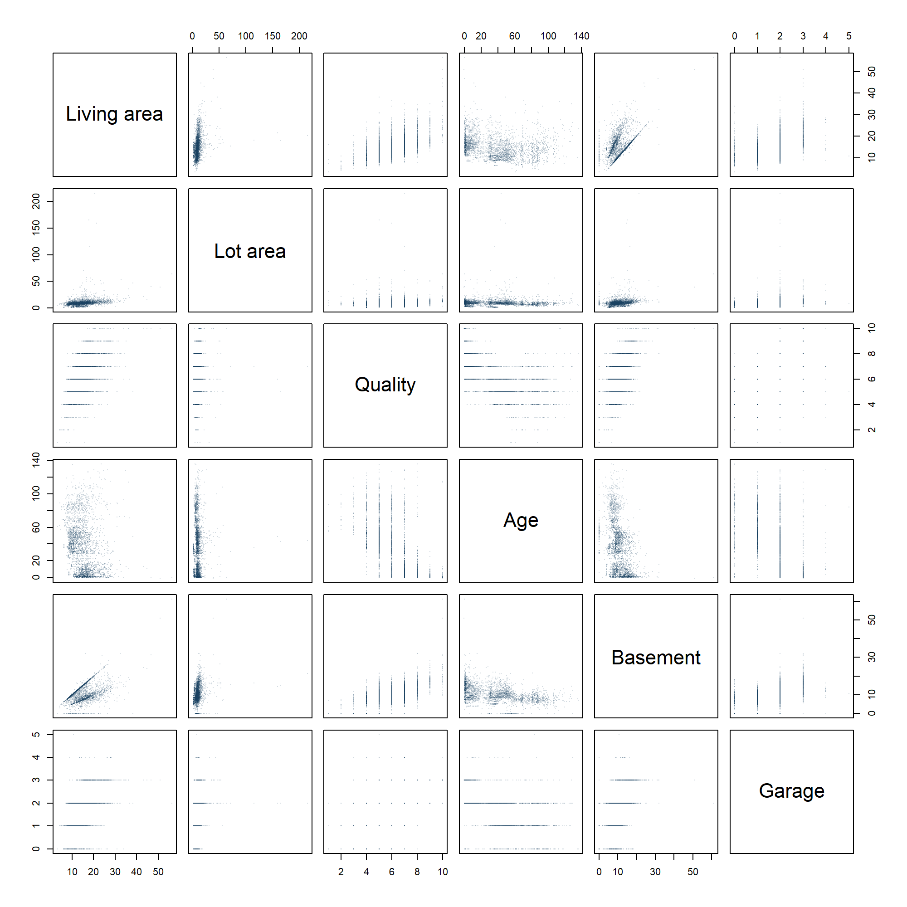

```{r setup, include=FALSE}
knitr::opts_chunk$set(echo=FALSE, message=FALSE, warning=FALSE, fig.pos='H')
# Run from the ames_proposal folder. Base R only; no package installation needed.
options(stringsAsFactors = FALSE)
dir.create('outputs', showWarnings = FALSE)
# [C] The grader runs this with the CSV files we upload to OneDrive (inside a folder named data/).
if (file.exists('data/AmesHousing_original.csv')) {
  raw <- read.csv('data/AmesHousing_original.csv', check.names = FALSE,
                  colClasses = 'character', na.strings = '', strip.white = TRUE)
} else {
  raw <- read.delim('data/AmesHousing_original.txt', check.names = FALSE,
                    colClasses = 'character', na.strings = '', strip.white = TRUE)
  write.csv(raw, 'data/AmesHousing_original.csv', row.names = FALSE, na = '')
}
stopifnot(nrow(raw) == 2930, ncol(raw) == 82)
num <- function(name) suppressWarnings(as.numeric(raw[[name]]))
d <- data.frame(PID=raw$PID, SalePrice=num('SalePrice'),
  Living100=num('Gr Liv Area')/100, Building=factor(raw[['Bldg Type']]),
  Lot1000=num('Lot Area')/1000, Quality=num('Overall Qual'),
  Age=num('Yr Sold')-num('Year Built'), Basement100=num('Total Bsmt SF')/100,
  GarageCars=num('Garage Cars'), Neighborhood=factor(raw$Neighborhood),
  SaleYear=factor(raw[['Yr Sold']]), SaleMonth=num('Mo Sold'))
d$Building <- relevel(d$Building, '1Fam')
d$Neighborhood <- relevel(d$Neighborhood, 'NAmes')
vars <- c('SalePrice','Living100','Building','Lot1000','Quality','Age',
          'Basement100','GarageCars','Neighborhood','SaleYear')
missing <- data.frame(Variable=vars, Missing=sapply(d[vars],function(x)sum(is.na(x))))
write.csv(missing,'outputs/missingness.csv',row.names=FALSE)
keep <- complete.cases(d[vars])
write.csv(d[!keep,],'outputs/excluded_missing.csv',row.names=FALSE)
clean <- droplevels(d[keep,])
stopifnot(nrow(clean)>=1000, !anyDuplicated(clean$PID), all(clean$SalePrice>0))
write.csv(clean,'data/AmesHousing_cleaned.csv',row.names=FALSE)
# Centering and unit changes aid interpretation; no log transform or outlier removal.
clean$LivingC <- clean$Living100 - 15
fit <- lm(SalePrice ~ LivingC*Building + Lot1000 + Quality + Age +
          Basement100 + GarageCars + Neighborhood + SaleYear, data=clean)
stopifnot(fit$rank == ncol(model.matrix(fit)))
write.csv(data.frame(n=nobs(fit),sigma=summary(fit)$sigma,
 adjusted_r_squared=summary(fit)$adj.r.squared),'outputs/metrics.csv',row.names=FALSE)
co <- summary(fit)$coefficients
ci <- confint(fit)
write.csv(data.frame(Term=rownames(co),Estimate=co[,1],SE=co[,2],
                    Lower=ci[,1],Upper=ci[,2],P=co[,4]),
          'outputs/coefficients.csv',row.names=FALSE)
numeric_vars <- vars[sapply(clean[vars],is.numeric)]
summ <- do.call(rbind,lapply(numeric_vars,function(v){
 x <- clean[[v]]
 data.frame(Variable=v,N=length(x),Mean=mean(x),SD=sd(x),Min=min(x),
            Q1=unname(quantile(x,.25)),Median=median(x),Q3=unname(quantile(x,.75)),Max=max(x))
}))
write.csv(summ,'outputs/numeric_summary.csv',row.names=FALSE)
cats <- do.call(rbind,lapply(setdiff(vars,numeric_vars),function(v){
 t <- table(clean[[v]])
 data.frame(Variable=v,Level=names(t),N=as.integer(t),Percent=100*as.integer(t)/nrow(clean))
}))
write.csv(cats,'outputs/categorical_summary.csv',row.names=FALSE)
slopes <- do.call(rbind,lapply(levels(clean$Building),function(b){
 L <- setNames(rep(0,length(coef(fit))),names(coef(fit))); L['LivingC'] <- 1
 if(b!='1Fam')L[paste0('LivingC:Building',b)] <- 1
 est <- sum(L*coef(fit)); se <- sqrt(drop(t(L)%*%vcov(fit)%*%L))
 data.frame(Building=b,Estimate=est,SE=se,Lower=est-qt(.975,df.residual(fit))*se,
            Upper=est+qt(.975,df.residual(fit))*se)
}))
write.csv(slopes,'outputs/area_slopes.csv',row.names=FALSE)
reduced <- update(fit,.~.-LivingC:Building)
test <- anova(reduced,fit)
write.csv(test,'outputs/interaction_test.csv')
influence <- data.frame(PID=clean$PID,CooksD=cooks.distance(fit),
 Leverage=hatvalues(fit),Studentized=rstudent(fit))
write.csv(influence[order(-influence$CooksD),],'outputs/influence.csv',row.names=FALSE)
png('outputs/diagnostics.png',width=2100,height=1400,res=180)
par(mfrow=c(2,3),mar=c(4.2,4.2,2.5,1),cex=.8)
plot(fit,which=1,id.n=3)
plot(fit,which=2,id.n=3)
plot(fit,which=3,id.n=3)
plot(fit,which=5,id.n=3)
plot(clean$Age,resid(fit),pch=16,col='#173f5f55',xlab='Age (years)',ylab='Residual (USD)',main='Residuals vs age')
lines(lowess(clean$Age,resid(fit)),col='red',lwd=2); abline(h=0,lty=2)
time <- as.numeric(as.character(clean$SaleYear))+(clean$SaleMonth-1)/12
plot(time,resid(fit),pch=16,col='#173f5f55',xlab='Sale year and month',ylab='Residual (USD)',main='Residuals vs sale time')
lines(lowess(time,resid(fit)),col='red',lwd=2);abline(h=0,lty=2)
dev.off()
png('outputs/interaction.png',width=2100,height=700,res=180)
par(mfrow=c(1,2),mar=c(4.2,4.5,2.4,1),cex=.85)
cols <- c('#176b87','#ba4a00','#6c3483','#229954','#b7950b')
plot(clean$Living100*100,clean$SalePrice,pch=16,col=adjustcolor(cols[clean$Building],alpha.f=.45),
 xlab='Above-ground living area (sq ft)',ylab='Sale price (USD)',main='Observed sales')
for (k in seq_along(levels(clean$Building))) {   # [C] one least-squares line per dwelling type
 dd <- clean[clean$Building == levels(clean$Building)[k], ]
 abline(lm(SalePrice ~ I(Living100*100), data=dd), col=cols[k], lwd=2.5)
}
legend('topleft',legend=levels(clean$Building),col=cols,lwd=2.5,cex=.7,bty='n')
plot(slopes$Estimate,seq_len(nrow(slopes)),xlim=range(slopes$Lower,slopes$Upper),yaxt='n',
 xlab='Adjusted price difference per 100 sq ft (USD)',ylab='',pch=19,col=cols,main='Type-specific slopes and 95% CIs')
axis(2,at=seq_len(nrow(slopes)),labels=slopes$Building,las=1)
segments(slopes$Lower,seq_len(nrow(slopes)),slopes$Upper,seq_len(nrow(slopes)),col=cols,lwd=2)
dev.off()
capture.output({cat('Original:',nrow(raw),' Complete:',nrow(clean),' Excluded:',sum(!keep),'\n');
 print(summary(fit));print(slopes);print(test);print(summ);
 cat('Largest finite Cook D:',max(influence$CooksD,na.rm=TRUE),'\n');
 cat('Leverage-one cases (undefined standardized diagnostics):',sum(influence$Leverage>1-1e-8),'\n');
 cat('Negative ages:',sum(clean$Age<0),'\n'); print(sessionInfo())},file='outputs/model_log.txt')
saveRDS(fit,'outputs/preliminary_model.rds')

# ---- [C] Full residual analysis: conditions + residuals vs every predictor (3 plots per row) ----
r <- resid(fit); yhat <- fitted(fit)
num_x <- c('Living100','Lot1000','Quality','Age','Basement100','GarageCars')
xlab_map <- c(Living100='Living area (100 sq ft)', Lot1000='Lot area (1,000 sq ft)',
              Quality='Overall quality (1-10)', Age='Age at sale (years)',
              Basement100='Basement area (100 sq ft)', GarageCars='Garage capacity (cars)')
big <- order(r)[1:3]                       # three most negative residuals
ptcol <- '#173f5f40'
png('outputs/residual_grid.png', width=2100, height=3300, res=200)
par(mfrow=c(5,3), mar=c(4,4,2.2,0.8), cex=.62)
plot(yhat, clean$SalePrice, pch=16, col=ptcol, xlab='Fitted values (USD)', ylab='Sale price (USD)',
     main='(a) Response vs fitted'); abline(0, 1, col='red', lwd=2)
plot(yhat, r, pch=16, col=ptcol, xlab='Fitted values (USD)', ylab='Residuals (USD)',
     main='(b) Residuals vs fitted'); abline(h=0, col='red', lwd=2)
lines(lowess(yhat, r), col='orange', lwd=2)
text(yhat[big], r[big], rownames(clean)[big], pos=2, cex=.8)
k <- 3
for (v in num_x) {
  plot(clean[[v]], r, pch=16, col=ptcol, xlab=xlab_map[[v]], ylab='Residuals (USD)',
       main=paste0('(', letters[k], ') Residuals vs ', tolower(sub(' \\(.*', '', xlab_map[[v]]))))
  abline(h=0, col='red', lwd=2); lines(lowess(clean[[v]], r), col='orange', lwd=2); k <- k + 1
}
boxplot(r ~ clean$Building, xlab='', ylab='Residuals (USD)', main='(i) Residuals by dwelling type', las=2, cex.axis=.8)
abline(h=0, col='red')
boxplot(r ~ clean$Neighborhood, xlab='', ylab='Residuals (USD)', main='(j) Residuals by neighborhood', las=2, cex.axis=.45)
abline(h=0, col='red')
boxplot(r ~ clean$SaleYear, xlab='', ylab='Residuals (USD)', main='(k) Residuals by sale year')
abline(h=0, col='red')
plot(time, r, pch=16, col=ptcol, xlab='Sale year and month', ylab='Residuals (USD)',
     main='(l) Residuals vs sale time'); abline(h=0, col='red', lwd=2)
lines(lowess(time, r), col='orange', lwd=2)
qqnorm(r, pch=16, col=ptcol, main='(m) Normal Q-Q plot'); qqline(r, col='red', lwd=2)
plot(hatvalues(fit), rstandard(fit), pch=16, col=ptcol, xlab='Leverage', ylab='Standardized residuals',
     main='(n) Residuals vs leverage'); abline(h=0, col='red')
dev.off()

png('outputs/pairs.png', width=2000, height=2000, res=200)
pairs(setNames(clean[num_x], c('Living area','Lot area','Quality','Age','Basement','Garage')),
      pch=16, cex=.25, col='#173f5f30')
dev.off()

# [C] Check the three most negative residuals against the codebook's special notes
partial_check <- data.frame(Row=rownames(clean)[big], LivingArea_sqft=clean$Living100[big]*100,
  SalePrice=clean$SalePrice[big], Residual=round(r[big]),
  SaleCondition=raw[['Sale Condition']][as.integer(rownames(clean)[big])])
write.csv(partial_check, 'outputs/largest_negative_residuals.csv', row.names=FALSE)

# [C] Readable labels for Table 2
term_lab <- c('(Intercept)'='Intercept',
  'LivingC'='Living area (per 100 sq ft, centred at 1,500)',
  'Building2fmCon'='Type: two-family conversion', 'BuildingDuplex'='Type: duplex',
  'BuildingTwnhs'='Type: townhouse (interior)', 'BuildingTwnhsE'='Type: townhouse (end unit)',
  'Lot1000'='Lot area (per 1,000 sq ft)', 'Quality'='Overall quality (per point)',
  'Age'='Age at sale (per year)', 'Basement100'='Basement area (per 100 sq ft)',
  'GarageCars'='Garage capacity (per car)',
  'LivingC:Building2fmCon'='Living area x two-family conversion', 'LivingC:BuildingDuplex'='Living area x duplex',
  'LivingC:BuildingTwnhs'='Living area x townhouse (interior)', 'LivingC:BuildingTwnhsE'='Living area x townhouse (end unit)')

```

**Working draft:** confirm Ames eligibility; replace team placeholders.

## Contributions
[Member A]: [actual contribution]. [Member B]: [actual contribution]. [Member C]: [actual contribution]. [Member D]: [actual contribution].

## Introduction
Among residential properties sold in Ames, Iowa, during 2006-2010, does the association between above-ground living area and sale price differ by dwelling type, after adjustment for lot area, construction quality, age, basement area, garage capacity, neighborhood, and sale year? Sale price is the recorded transaction amount in nominal US dollars. Rather than assuming a universal price-per-square-foot relationship, we estimate the adjusted sale-price difference associated with 100 additional square feet within each dwelling type. These estimates describe associations, not the causal return from enlarging a home.

Housing attributes need to be considered jointly, and past research highlights several key variables. Mathur (2019), studying King County, Washington, found that construction quality and maintenance were associated with higher prices. A medium-quality home sold for approximately 25% more than a low-quality home. This supports adjustment for quality, while the maintenance findings motivate considering condition in subsequent models. Goodman and Thibodeau (1995) analyzed nearly 8,500 Dallas single-family transactions. They found nonlinear depreciation and age-related heteroskedasticity. These findings motivate including age and checking both functional form and residual variance. Fik et al. (2003), studying the Tucson housing market, found that location and housing attributes jointly influenced prices in ways that simple location indicators did not fully capture. This motivates neighborhood adjustment, while recognizing that spatial dependence may remain.

Together, these studies support an adjusted analysis while warning against a universal price-per-square-foot rule. Our extension asks whether the living-area slope varies across five recorded dwelling types in Ames. We hypothesize that differences in layout and shared structures make a common slope too restrictive. We build on those studies by comparing what an extra 100 square feet means for the sale price of a detached home, a duplex, or a townhouse in Ames.

Multiple linear regression estimates conditional mean-price differences while adjusting for several characteristics simultaneously. A correlation or comparison of group means cannot isolate the adjusted area association or test whether slopes differ. Type-specific slopes, confidence intervals, and a joint partial F-test of the four interaction coefficients answer the question. The outcome is sufficiently continuous for this approach, subject to diagnostic assessment. An appraiser comparing historical Ames sales could use these estimates to judge whether 100 additional square feet carried the same price difference for a duplex as for a detached home. Our estimates reflect sales in Ames from 2006 to 2010. The same amount of space may be priced differently today or in another city.

## Data description
Our data and codebook come from Dean De Cock’s (2011a, 2011b) publication in the Journal of Statistics Education. The Ames City Assessor's Office originally recorded property characteristics and sales for valuation and assessment. To prepare the records for linear regression analysis, De Cock removed nonresidential properties, filtered out specialized tax variables, and kept only the most recent sale for repeatedly sold homes, leaving 2,930 residential properties across 82 fields.

The analysis uses 2,928 complete records, excluding two properties missing basement area or garage capacity. Sale price has a mean of $180,841, median of $160,000, standard deviation of $79,890, and range from $12,789-$755,000. Because sale price takes many dollar values, we treat it as continuous. Right-skewness in raw prices does not violate regression assumptions, which apply to conditional errors. Keeping one sale per parcel ID (PID) prevents repeated-measures dependence, though neighboring properties and shared market conditions may still induce correlated errors.

Our model includes nine predictors: living area, dwelling type, lot area, overall quality, age at sale, basement area, garage capacity, neighborhood, and sale year. Dwelling type and neighborhood are nominal; sale year is a factor. Quality is provisionally treated as a numerical 1-10 score, imposing equal increments. Living area is measured per 100 square feet and centered at 1,500 square feet; lot area is per 1,000 square feet and basement area per 100 square feet. These linear rescalings aid interpretation without affecting model assumptions.

A living-area-by-dwelling-type interaction allows distinct slopes across detached homes, two-family conversions, duplexes, and interior or end-unit townhouses. Because dwelling type is already categorical, no arbitrary numerical cutoffs are needed. Layout differences and the diverging trends in Figure 2 motivate this term. Table 1 summarizes the sample: price and area distributions have long upper tails, categories are imbalanced (e.g., the Landmark neighborhood has one observation), and one record with age $-1$ is retained for diagnostic review.

```{r summary-tables, results="asis"}
knitr::kable(read.csv('outputs/numeric_summary.csv'), digits=2, row.names=FALSE)
knitr::kable(read.csv('outputs/categorical_summary.csv'), digits=2, row.names=FALSE)
knitr::kable(read.csv('outputs/missingness.csv'), row.names=FALSE)
```

## Ethics discussion
The Ames Housing dataset uses real sales records from the Ames City Assessor’s Office. It is not simulated data. De Cock (2011b) explains where the data came from, and a codebook is provided to explain the variables. This makes the dataset more trustworthy, but it does not mean the data are perfect. For example, one house has a calculated age of -1, and the overall quality score may depend on the assessor's judgment. Also, the data only include houses sold in Ames from 2006 to 2010, so the results may not apply to other places.

We also need to consider privacy and consent. The records were originally collected for property assessment, and we cannot confirm whether homeowners agreed to their use in research. Even without names, some property details might be matched with other records. We will not try to identify any owners.

For ownership, the records came from the Assessor's Office and were later published by De Cock. We will acknowledge both and use the dataset only for this project. One neighborhood has only one sale, so we will avoid publishing its parcel details or drawing conclusions about the neighborhood from that sale.

## Preliminary results
The preliminary model (Table 2) regresses sale price on nine predictors plus a living area × dwelling type interaction (adjusted R² = 0.839; residual SE = $32,073).

For detached homes, 100 additional square feet is associated with a $4,860 higher mean price (95% CI $4,507–$5,212), holding other predictors fixed. The corresponding slopes are $2,419 for two-family conversions, $1,900 for duplexes, $1,832 for interior townhouses and $6,042 for end-unit townhouses (Figure 2). The preliminary F-test suggests that the area slopes differ across dwelling types (F(4, 2882) = 9.20, p < 0.001). The widening residual spread in Figure 1b makes the p-value and confidence intervals provisional.

Figure 3 summarizes pairwise associations among the numeric predictors. At high fitted prices, observed prices bend above the identity line (Figure 1a). Residuals curve against fitted price (Figure 1b), living area (1c), and basement area (1g), suggesting that the model misses some nonlinear structure. Constant variance is violated: residual spread increases with fitted price (Figure 1b). Uncorrelated errors appear reasonable: residuals show no trend over sale time (Figure 1l), though nearby homes may share unmeasured influences. Normality is violated: the Q-Q plot (Figure 1m) shows heavy tails. The three largest negative residuals (rows 1499, 2181 and 2182) are partial sales above 4,000 square feet, which De Cock (2011b) flags as unlikely to reflect market value; Landmrk has a single sale (leverage one, Figure 1n). No corrections are applied at this stage.

The quality coefficient ($15,672 per point) agrees in direction with Mathur (2019), the negative age coefficient (−$404 per year) is consistent with depreciation reported by Goodman and Thibodeau (1995), though our residual spread is largest for newer homes, and large neighborhood effects echo Fik et al. (2003). Unexpectedly, end-unit townhouses have a larger estimated slope than detached homes, but the difference is not significant (95% CI −$326 to $2,690). GrnHill (2 sales) and Landmrk (1) give unstable estimates.

```{r residual-grid, out.width="75%", fig.align="center", fig.cap="Residual diagnostics for the preliminary sale-price model. Residuals curve and spread out at higher fitted prices (b), and the normal Q-Q plot shows heavy tails (m). Orange curves show local trends. Labels in (b) identify the three most negative residuals by original data row."}

```

```{r interaction, out.width="100%", fig.cap="Observed sales with a least-squares line for each dwelling type (left) and adjusted living-area slopes with 95% CIs (right)."}

```

```{r pairs, out.width="60%", fig.align="center", fig.cap="Pairwise scatterplots of the numerical predictors."}

```

Table 2. Preliminary model, USD. References: detached home, North Ames, 2006. Dwelling-type contrasts are at 1,500 sq ft; interactions are slope differences per 100 sq ft. Neighborhood and sale-year effects are included but not shown.

```{r coefficients, results="asis"}
cf <- read.csv('outputs/coefficients.csv')
cf <- cf[cf$Term %in% names(term_lab), ]
fmt <- function(x) format(round(x), big.mark=',', trim=TRUE)
tab2 <- data.frame(Term=term_lab[cf$Term], Estimate=fmt(cf$Estimate), SE=fmt(cf$SE),
                   `95% CI`=paste0('[', fmt(cf$Lower), ', ', fmt(cf$Upper), ']'), check.names=FALSE)
knitr::kable(tab2, row.names=FALSE, align='lrrr')
```

## Plan
We will retain living area, dwelling type, and their interaction because our question compares area slopes across types. Neighborhood and sale year will remain controls for location and market timing. Mathur (2019) motivates testing whether overall condition adds information beyond quality. Once diagnostics support inference, we will use partial F-tests to compare nested models fitted to the same sales on the same response scale. We will compare the model with and without condition. To assess simplification, we will test removing basement area and garage capacity jointly and check how much the estimated dwelling-type slopes change before dropping either control.

Figure 1b shows residual spread increasing with fitted price. We will try log price and use a Box–Cox profile to assess whether a log transformation is plausible. If curvature against living area persists (Figure 1c), we will try a squared centered-area term while retaining its linear term. After each refit, we will inspect residuals against fitted values and predictors for curvature and changing spread, the normal Q–Q plot for heavy tails, and residuals in sale order for dependence. We will compare slopes with and without the three flagged partial sales to see how sensitive our answer is to their inclusion. If we select log price, we will express area contrasts as percentage differences.

By November 15, [Members A/C] will complete diagnostics and model comparisons. By November 20, [Members B/D] will check interpretations and finish the poster. All members will rehearse and record by November 25, then verify the files by November 28.

## Bibliography
De Cock, D. (2011a). *Ames housing* [Data set and codebook]. Journal of Statistics Education. [Data set](https://jse.amstat.org/v19n3/decock/AmesHousing.txt) · [Codebook](https://jse.amstat.org/v19n3/decock/DataDocumentation.txt)

De Cock, D. (2011b). Ames, Iowa: Alternative to the Boston housing data as an end of semester regression project. *Journal of Statistics Education, 19*(3). https://doi.org/10.1080/10691898.2011.11889627

Fik, T. J., Ling, D. C., & Mulligan, G. F. (2003). Modeling spatial variation in housing prices: A variable interaction approach. *Real Estate Economics, 31*(4), 623–646. https://doi.org/10.1046/j.1080-8620.2003.00079.x

Goodman, A. C., & Thibodeau, T. G. (1995). Age-related heteroskedasticity in hedonic house price equations. *Journal of Housing Research, 6*(1), 25–42. https://www.jstor.org/stable/24825889

Mathur, S. (2019). House price impacts of construction quality and level of maintenance on a regional housing market: Evidence from King County, Washington. *Housing and Society, 46*(2), 57–80. https://doi.org/10.1080/08882746.2019.1601928

